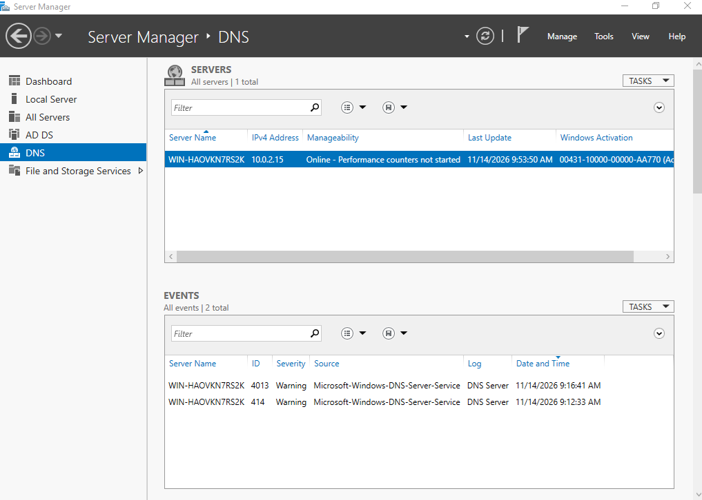

Laboratório Prático: Active Directory e Gestão de Acessos 

Simulação de um ambiente corporativo utilizando virtualização para o gerenciamento centralizado de utilizadores, departamentos e serviços de rede.

Tecnologias e Ferramentas Utilizadas
**Virtualização:** Oracle VM VirtualBox
**Servidor:** Windows Server 2019 (Active Directory Domain Services - AD DS e DNS)

Etapas Executadas
1. **Controlador de Domínio:** Implementação da função AD DS e criação do domínio interno `empresa.local`.
2. **Estrutura Organizacional:** Criação de Unidades Organizacionais (OUs) para os departamentos (`Ti`, `RH`, `Financeiro`) e registo de colaboradores.
3. **Serviços de Rede:** Validação do funcionamento do Servidor DNS interno.

Evidências do Laboratório
### 1. Painel de Utilizadores e Departamentos (Active Directory)

### 2. Gestão do Servidor e DNS

